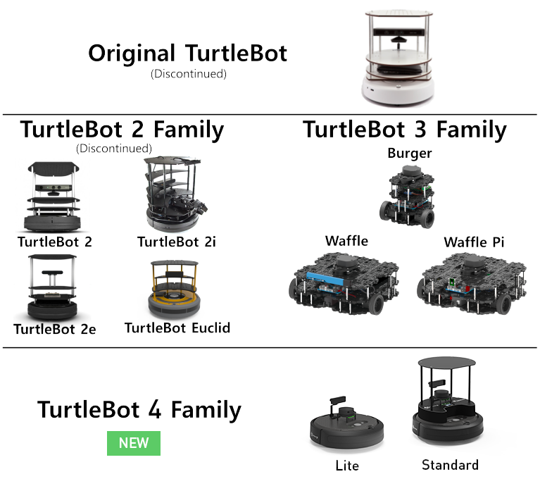
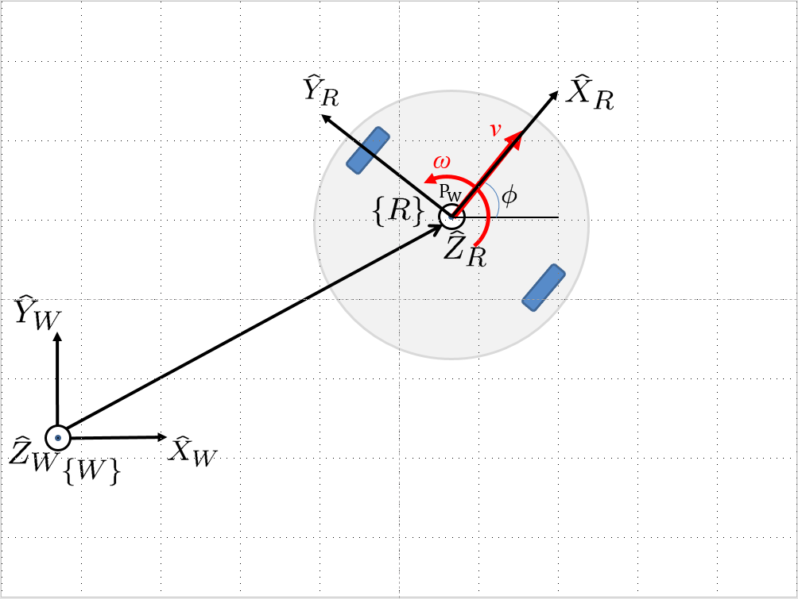

Lab 3: Open Loop Control
========================

Overview
--------

In this lab, we are going to learn how to write a Python script to control the Turtlebot4 robot.
Specifically, the task is to make the robot move in a square shape using open-loop control 
(i.e. sending commands only; no feedback). 
The waypoints to visit are [4, 0], [4, 4], [0, 4] and [0, 0]. 
In other words, the robot should move forward 4 meters, turn left 90 degrees, 
move forward again 4 meters, and so on, until going back to the origin. 
Note that the robot is supposed to stop at the origin after completing this square movement,
and the Python script should exit gracefully. 

Introduction to Turtlebot
-------------------------

The Turtlebot4 robot is a differential wheeled robot built on top of the iRobot Create 3 mobile base.
See the image (right) below for Turtlebot family. 

Though multiple layers of plates/sensors are placed on top of the robot, 
the kinematics of the robot can be simplified according to the property 
of its mobile base, which uses differential drive for locomotion.
The differential mobile base has two powered wheels, located symmetrically about its center. 

As users, we can send high-level commands (linear velocity ``v`` and angular velocity ``ω``) 
to the robot. The mobile base will first transform the ``v`` and ``w`` commands with respect to the 
robot center into the desired rotational speed of each wheel, and then control the rotational
speed by a feedback control of the current of the motor that drives the wheel. 

To describe the position and orientation of the robot, 
we attach a robot coordinate frame :math:`R` to it. 
The origin of this coordinate frame is centered between its powered wheels. 
The X axis of this frame is pointing forward (along the direction of the linear velocity ``v``),
the Y axis is pointing to the left, and the Z axis is pointing up.

To track the position and orientation of the robot, we generally define a world 
reference frame :math:`W`, in the same plane where the robot moves. 
With this frame assignment, the robot’s position is constrained to the X − Y plane of frame :math:`W`. 
Moreover, any rotation between the robot and the world frames can be expressed 
as a rotation about Z axis. 
Therefore, the position of the robot with respect to the world reference frame will have the form:

.. math::

  P_W = 
  \begin{bmatrix}
  x    \\
  y    \\
  0     
  \end{bmatrix}

while the rotation matrix expressing the orientation of the robot frame 
with respect to :math:`W` will be of the from:

.. math::

  R_{WR} = 
  \begin{bmatrix}
  cos(\phi) & -sin(\phi) & 0  \\
  sin(\phi) & cos(\phi) & 0   \\
  0 & 0 & 1     
  \end{bmatrix}

.. Installation Steps
.. ----------------

.. First, let’s upgrade existing packages and install some dependencies for Turtlebot.

..  .. code-block:: bash

..     sudo apt-get update
..     sudo apt-get upgrade

.. Then, we clone and install the turtlebot3 ROS packages in our ROS workspace,

..   .. code-block:: bash

..       cd ~/catkin_ws/src/
..       git clone -b noetic-devel https://github.com/ROBOTIS-GIT/turtlebot3.git
..       git clone -b noetic-devel https://github.com/ROBOTIS-GIT/turtlebot3_msgs.git
..       git clone -b noetic-devel https://github.com/ROBOTIS-GIT/turtlebot3_simulations.git
..       cd ../

.. and then we **build** the workspace. 😉

.. Gazebo and Turtlebot3 Simulation
.. ----------------

.. In order to spawn the Gazebo inside the simulated world, first we define the type of its model (burger, waffle, waffle_pi), and then we execute the ROS launch script,

..   .. code-block:: bash

..     export TURTLEBOT3_MODEL=burger
..     roslaunch turtlebot3_gazebo turtlebot3_empty_world.launch

.. The turtlebot3 supports teleoperation through `geometry_msgs/Twist` commands, via the corresponding ROS topic. To use a developed teleoperation script you can execute in a separate terminal,

..   .. code-block:: bash

..     rosrun turtlebot3_teleop turtlebot3_teleop_key

Sample Code
-----------

A sample code is provided to make the robot move forward for a certain distance.
Please read carefully the provided code, and understand its functionality.
You need to make changes under ``run`` function to complete the square trajectory.

- Open a new terminal and go to your ``ee106f26`` package. 
  We will start from a new Python script. You can use an editor of your choice. For demonstration, we're using `gedit`.

  .. code-block:: bash

    cd ~/ee106_ws/src/ee106f26/scripts
    touch open_loop.py
    gedit open_loop.py

- Please copy and paste the following code, then save and close it.

  .. code-block:: python

    #!/usr/bin/env python3

    import rclpy
    import threading
    import time

    import numpy as np

    from math import pi

    from rclpy.node import Node
    from geometry_msgs.msg import TwistStamped

    class Turtlebot(Node):

        def __init__(self):

            # Create and initialize the Node - this is required
            super().__init__('turtlebot_move')

            self.get_logger().info("Press Ctrl + C to terminate")

            # Create publisher for publishing the velocity commands
            self.vel_pub = self.create_publisher(TwistStamped, "cmd_vel", 10)

        def run(self):
            """
            Run function. There are a variety of design patterns.
            An alternative would have been to use the `timer_callback`
            design pattern shown in previous labs.
            """

            # Create a Twist object
            # Essentially it's going to publish the velocity
            vel = TwistStamped()

            # Populate the fields of the message
            vel.twist.linear.x = 0.5
            vel.twist.angular.z = 0.0

            # Provide some time to undock
            time.sleep(1)

            self.get_logger().info("Undocking complete.")
            self.get_logger().info('Running open-loop control...')

            # TODO: Modify / Add code after this point
            # SAMPLE: Go Straight
            for _ in range(100):
                self.vel_pub.publish(vel)
                time.sleep(0.1)

    def main(args=None):
        """
        Entry point function for the Open Loop control node.

        @param args - Arguments that need to be passed to ROS.
        """

        # Initialize the client library - this is required
        rclpy.init(args=args)

        # Create the publisher node
        turtlebot_node = Turtlebot()

        # Spin so that the node is busy processing
        # while no exceptions are encountered and ROS
        # is executing
        # For this lab - spin rclpy on separate thread
        thread = threading.Thread(target=rclpy.spin, args=(turtlebot_node,), daemon=True)
        thread.start()

        # Allow time for other nodes to start
        time.sleep(5)

        try:
            turtlebot_node.run()
        except KeyboardInterrupt:
            pass

        # Destroy the node explicitly
        turtlebot_node.destroy_node()

        # Shut down this context
        rclpy.shutdown()

    if __name__ == '__main__':
        main()

Sample Code Explained
---------------------

- Now, let's break the code down.

- The first line makes sure your script is executed as a Python script in Linux.
  You need this line if you want to run it as a regular executable (i.e. run by ``./filename.py``) in Linux.
  
  .. code-block:: python

    #!/usr/bin/env python3

- You need to import `rclpy` in order to use ROS in Python. This is the Python library that contains common operations and resources in ROS.
  You will also need to import the `Node` class from `rclpy.node` in order to create the `Node` object.

  .. code-block:: python

    import rclpy

    from rclpy.node import Node

- This line imports a ``TwistStamped`` *class* that can carry linear and angular velocity information. 
  Later on we will need to create an *instance* of this class, 
  assign the velocity value, and publish it out to the robot.

  .. code-block:: python

    from geometry_msgs.msg import TwistStamped

- We import a high-precision value of pi (in radian) from math library. Print it out and see its value :)
  This is for your convenience to add the turning part of the code.

  .. code-block:: python

    from math import pi

- We use *class* to better organize resources (variables and functions) in Python scripts.
  With *class*, we can easily update the value of a variable in one function and have access to it
  from another member function. 

- In the following code structure, we first define a *class* named ``Turtlebot``, and then create
  an *instance* (*object*) called ``turtlebot_node`` in the Python main function.
  The Python program will start running from the line right after ``if __name__ == '__main__':``.
  However, to create a new instance, the program needs to run ``__init__`` function for once 
  (this is a function that every *class* must have for the initialization process).
  We then call ``run`` function under ``__init__`` function. 
  As such, each component is connected into the running pipeline. 
  
- The keyword ``self`` is a pointer used internally to refer to resources, and the keyword
  ``pass`` is just a placeholder that actually does nothing. The ``Turtlebot`` class itself inherits
  from the ``Node`` class, 

  .. code-block:: python
    
    class Turtlebot(Node):
        def __init__(self):
            pass

        def run(self):
            pass

    if __name__ == '__main__':
        turtlebot_node = Turtlebot()
        ...
        turtlebot_node.run()

- A ROS Node needs to be *spun* in order to do its work. ``rclpy.spin(node)`` keeps the node alive and
  processes its *callbacks*, i.e. the functions that ROS calls for us when something happens, such as a new message
  arriving on a subscribed topic or a timer firing. It is a blocking call - it does not return
  until the node is shut down, so any line written after it would never run.

- In this lab, we want to run our own loop in ``run`` (publish, sleep, repeat) while the node is spinning.
  To do both at the same time, we start ``rclpy.spin`` on a separate *thread*, which runs in the background
  alongside the main program. Setting ``daemon=True`` means this background thread is stopped automatically
  when the main program finishes. We then wait a few seconds so the node can connect to the other ROS Nodes
  before ``run`` starts sending commands. For the time being, we do not need to know more details on this.

  .. code-block:: python

    thread = threading.Thread(target=rclpy.spin, args=(turtlebot_node,), daemon=True)
    thread.start()

    time.sleep(5)

    turtlebot_node.run()

  Our open-loop node only publishes, so it does not have any callbacks yet. Spinning in the background becomes
  essential once we add subscribers (e.g. to read the robot's odometry for feedback control), since their callbacks
  only run while the node is spinning.

- The ``try-except`` block is used to handle exceptions. In this case, it will catch the ``Ctrl + C`` as an interruption and do nothing.
  The general paradigm is to print some useful information about the exception that was caught, and additionally perform some cleanup. 
  For the time being, we do not need to know more details on this.

  .. code-block:: python
    
    if __name__ == '__main__':
        turtlebot_node = Turtlebot()
        try:
            turtlebot_node.run()
        except KeyboardInterrupt:
            pass

.. - In ROS, we have a ROS Master (or ``roscore``) running as a central server to manage global resources
..   and connect all ROS Nodes.
..   Each program will need to talk to this central server first before talking to other program 
..   (this process is, in other words, to register itself as a ROS Node).

- In each and every Python script running ROS, the first thing to do is to initialize itself as a ROS Node. 
  The argument ``turtlebot_move`` is the name we would like to assign to this ROS Node. 

  .. code-block:: python

    super().__init__('turtlebot_move')

- What follows is a common logging function used in ROS. In addition to printing the message
  to screen (as what ``print`` function does in Python), it can also save the log under ``~/.ros/log``.

  .. code-block:: python

    self.get_logger().info("Press Ctrl + C to terminate")

- ROS Topic is a way that ROS Node communicates with each other for continuous data transmission. 
  (In this case, we keep sending velocity commands.)
  For one-time short communication, we also have ROS Service, which will not be covered in this course.
  
- On the robot side, there is a ROS Subscriber waiting for velocity commands.
  What we need to do in this script is to create a ROS Publisher to send commands.
  The required arguments are the message type ``TwistStamped``, the topic name, and the queue size ``10``.

  .. code-block:: python

    self.vel_pub = self.create_publisher(TwistStamped, "cmd_vel", 10)

- The following question is how frequently we should send velocity commands.
  Note that the robot will stop if no velocity command is received after a while,
  and the robot may "panic" if thousands of commands are received in a second.
  Therefore, we can pick a moderate rate at 10Hz (i.e. 10 commands per second).

- We use the ``time`` module to help us manage the timing. 
  By using the ``time.sleep()`` function together with ``while`` or ``for`` loop,
  we can approximately keep the loop running at 10Hz rate.
  The ``time.sleep(0.1)`` function pauses the program for 0.1 s each time it is called.

  .. code-block:: python

    for _ in range(100):
      self.vel_pub.publish(vel)
      time.sleep(0.1)

.. The ``time.sleep()`` function can calculate how much time elapsed **since last time 
.. it was called**. If this time elapsed is less than 1/rate (in this case 0.1s),
.. it will block the program till the time has reached 1/rate. 
.. If the time has already exceeded 1/rate, it will simply let it go.

- To prepare a ROS Message that contains velocity data, 
  we first create an *instance* (called ``vel``) of the ``TwistStamped`` class 
  (which is the message we are about to send), 
  and then assign linear and angular velocity to its corresponding variable.
  Note that you need to use ``.`` to have access to the member variables of a *class* data structure.
  See `ROS Wiki documentation <https://docs.ros.org/en/jazzy/p/geometry_msgs/msg/TwistStamped.html>`_ 
  for more information about the message definition. 

  .. code-block:: python

        vel = TwistStamped()
        vel.twist.linear.x = 0.5
        vel.twist.angular.z = 0.0
        self.vel_pub.publish(vel)

.. - Lastly, if you use ``while`` loop, it is highly recommended to add a condition
..   to check if the ROS server is still alive. 
..   This can help terminate the Python script whenever you press ``Ctrl + C`` in the terminal. 
..   On the contrary, dead loop like ``while True: xxx`` will not respond to your shutdown commands
..   (unless you add proper ``break`` condition in the loop).
  
..   .. code-block:: python

..     while not rospy.is_shutdown():
..         pass

Build & Run
-----------

#. First, open up the simulator in one window with the TurtleBot 4 Lite model:

.. code-block:: bash

    ros2 launch ee106f26 turtlebot.launch.py model:=lite world:=empty

#. In another terminal window, navigate to the ee106 workspace directory and execute the open loop node:

.. code-block:: bash

    cd ~/ee106_ws
    source install/local_setup.bash
    colcon build
    ros2 run ee106f26 open_loop.py

Programming Tips
----------------

#. We follow ROS conventions to use `SI units <https://en.wikipedia.org/wiki/International_System_of_Units>`_.
   (i.e. length in meter, time in second, angle in radian). 
   See ROS Wiki article `REP 103 Standard Units of Measure and Coordinate Conventions 
   <https://www.ros.org/reps/rep-0103.html>`_ for more information. 

#. When a new robot is spawned, the forward heading direction is the positive x axis; 
   the leftward direction is the positive y axis; and by right-hand rule, z axis upward. 
   This is also specified in `REP 103 <https://www.ros.org/reps/rep-0103.html>`_. 

#. In this lab, you need to finely tune the parameters for open-loop control. 
   
   - In Gazebo, you can take the visualization as feedback (the grid size of the ground is 1 meter) 
     to tune the parameters. 

  .. #. In Gazebo, you can use ``Ctrl + R`` to set the robot back to the origin without the need to relaunch.
  ..  - On Gradescope autograder, you can take the evaluation results (visited waypoints) as feedback 
  ..    to make minor adjustments to the parameters you have already tuned in the VM.
  ..  - Please note that parameters may vary from platform to platform. In other words,
  ..    the parameters work in your VM may not necessarily work in the cloud server running autograder.

Reading Materials
-----------------

ROS Nodes
~~~~~~~~~

- `Understanding ROS Nodes <https://docs.ros.org/en/jazzy/Tutorials/Beginner-CLI-Tools/Understanding-ROS2-Nodes/Understanding-ROS2-Nodes.html>`_

- `Initialization and Shutdown <https://docs.ros.org/en/jazzy/p/rclpy/api/init_shutdown.html>`_

ROS Topics and Messages
~~~~~~~~~~~~~~~~~~~~~~~

- `Interfaces <https://docs.ros.org/en/jazzy/Concepts/Basic/About-Interfaces.html>`_

- `Understanding ROS Topics <https://docs.ros.org/en/jazzy/Tutorials/Beginner-CLI-Tools/Understanding-ROS2-Topics/Understanding-ROS2-Topics.html>`_

- `Publishers and Subscribers <https://docs.ros.org/en/jazzy/Tutorials/Beginner-Client-Libraries/Writing-A-Simple-Py-Publisher-And-Subscriber.html>`_

ROS Conventions
~~~~~~~~~~~~~~~

- `REP 103 Standard Units of Measure and Coordinate Conventions 
  <https://www.ros.org/reps/rep-0103.html>`_

- `REP 105 Coordinate Frames for Mobile Platforms <https://www.ros.org/reps/rep-0105.html>`_

Submission
----------

#. Submission: individual submission via Gradescope.

#. Due time: 11:59pm, October 29, Thursday

#. Files to submit (inside a ``.zip`` file): 

   - lab3_report.pdf
   - open_loop.py

#. Grading rubric:

   + \+ 50%  Clearly describe your approach and explain your code in the lab report. Capture a panoramic ``video`` of the robot demonstrating the followed trajectory inside the Gazebo world. You can use the `simplescreenrecorder` software, by installing it with,

    .. code-block:: bash

      sudo apt-get update
      sudo apt install simplescreenrecorder

   + \+ 40%  The robot can visit all four vertices of the square trajectory (error < 1.0m). 
     Partial credits will be given according to the number of vertices visited.
   + \+ 10%  The script can complete the task on time and exit gracefully.
   + \- 15%  Penalty applies for each late day. 

Grading
----------

#. Under Gazebo simulation environment, the submitted Python script will be run for once and the robot trajectory will be saved into csv files.
#. The scores will be given by evaluating the saved trajectory. Testing parameters are as follows.
   The tolerance for distance error is set to 1.0m (considering this is open-loop control).
   For example, passing point [3.6, 3.4] is approximately equivalent to passing point [4.0, 4.0].
   If running properly, the task in this lab can be done in about 1 min, based on our testing.
   It is important that your script can exit gracefully after task completion.

.. All code submissions will be graded automatically by an autograder uploaded to Gradescope.
.. Your scripts will be tested on a Ubuntu cloud server using a similar ROS + Gazebo environment.
.. The grading results will be available in a couple of minutes after submission.
.. The autograder works in the following way (no action on your side needed; just to explain).

.. #. The time limit for the submitted script is set to 5 mins.

..    - If running properly, the task in this lab can be done in about 1 min, based on our testing.
..    - If running timeout, the script will be terminated and a 10% penalty will apply.
..    - Therefore, it is important that your script can exit gracefully after task completion.
..      (Just avoid using infinite loops and/or remember to add a break condition.)

.. #. The global time limit on Gradescope server is set to 10 mins. 

..    - If running timeout, the entire grading process will be terminated and you will have no grading results. 
..    - This can happen if you have dead loop in the script (e.g., ``while True: xxx``)
..      and the autograder is not able to terminate the script. 
..      (Scripts like this cannot be terminated by ``Ctrl + C`` in terminals, if you test it yourself.)
