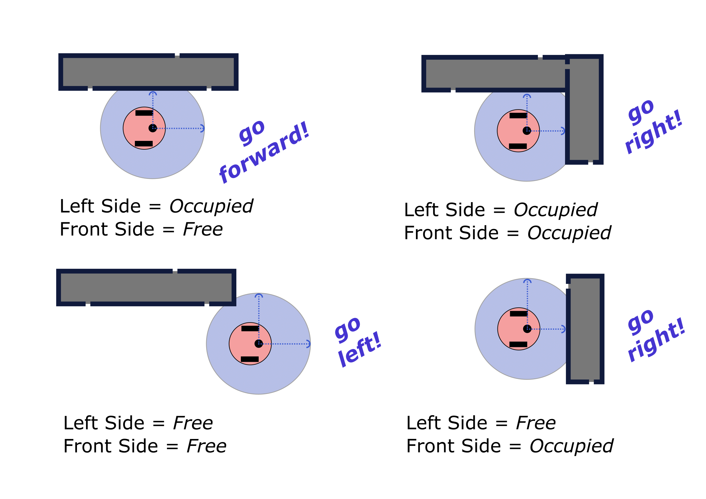

Lab 5: ROS Services and Wall Following
====================

Overview
--------

In this lab, we will expand our knowledge of working with ROS by using ROS Services, and we will compare it with the use of ROS Topics in the previous labs. In addition, we will create two new ROS Nodes that will communicate with a ROS Service call, and in the end, we will create a new customized ROS Service type.

ROS Services: Request and Response
----------

As seen in the previous labs, ROS Topics are used to stream data between ROS Nodes to help in their communication and exchange of information to perform a more complex task. ROS Services represent also a way of communication within ROS Nodes, but they are mainly based on request and response interactions. 

Specifically, a ROS Service is described by specific data fields, as a type of a ROS Topic, however, there is a distinction between request and response fields that use different parameters. For example, the `rclpy/AddTwoInts <https://docs.ros.org/en/jazzy/Tutorials/Beginner-Client-Libraries/Writing-A-Simple-Py-Service-And-Client.html>`_ is a ROS Service that has been created by ROS Python online tutorials to demonstrate the ROS service request of adding two different numbers. 

.. code-block:: bash

 int64 a
 int64 b
 ---
 int64 sum

Initially, the separation line `--` separates the request and response parameters. In our example, the `int64` ``a`` and `int64` ``b`` are the parameters of the request of the ROS service, that need to be set before the service call. Thus, with the service call, the ROS node that has initialized the ROS Service triggers its function and forms the response variables, which will be returned. On the service caller side, the caller node will get back the output (response) of the ROS Service call and will store it locally to be accessed.
As it is obvious, the request and response variables can be more than one, depending on the used ROS Service.

The ``ros2 service`` bash command can be used in the same way as the ``ros2 topic`` command, to preview further information about the available ROS Services. For example, the argument ``list`` is used to list all the available ROS Services,

.. code-block:: bash

 ros2 service list

The `info` argument is used to show information about the selected ROS Service, i.e. `add_two_ints`.

.. code-block:: bash

 ros2 service info add_two_ints

To preview the full use of the ``ros2 service`` command you can use the ``help`` argument, such as,

.. code-block:: bash

 ros2 service -h

Notably, the ``ros2 serive`` bash command is used to display information about ROS Service types, such as,

.. code-block:: bash

 ros2 interface show example_interfaces/srv/AddTwoInts
 

ROS Service Use Example
----------

Let's see an example by using the `rclpy/AddTwoInts` ROS Service. First, create a new ROS Publisher and Subscriber node, as followed on our `ROS tutorial <https://ucr-robotics.readthedocs.io/en/latest/intro_ros.html>`_ and name them `node_a.py` and `node_b.py` under the ``ee106w26`` ROS package. In addition, modify both the ``node_a`` and ``node_b`` to the following,

.. code-block:: python
   :emphasize-lines: 6,16,17,25-41
 
   #!/usr/bin/env python3
 
   import rclpy
   from rclpy.node import Node
   from std_msgs.msg import String
   from example_interfaces.srv import AddTwoInts
 
 
   class NodeA(Node):
 
       def __init__(self):
           super().__init__('node_a')
           self.pub = self.create_publisher(String, 'chatter', 10)
           self.timer = self.create_timer(0.1, self.timer_callback)  # 10hz
 
           # ROS Service client for 'add_two_ints'
           self.client = self.create_client(AddTwoInts, 'add_two_ints')
 
       def timer_callback(self):
           now = self.get_clock().now()
           msg = String()
           msg.data = 'welcome to the Robotics Lab ' + str(now.nanoseconds / 1e9)
           self.pub.publish(msg)
 
           # Call of the ROS Service 'add_two_ints'
           if not self.client.service_is_ready():
               self.get_logger().warn('Service add_two_ints not available yet')
               return
 
           request = AddTwoInts.Request()
           request.a = 2
           request.b = 1
           future = self.client.call_async(request)
           future.add_done_callback(self.service_response_callback)
 
       def service_response_callback(self, future):
           try:
               response = future.result()
               self.get_logger().info(str(response))
           except Exception as exc:
               self.get_logger().error('Service did not process request: ' + str(exc))
 
 
   def main(args=None):
       rclpy.init(args=args)
       node = NodeA()
       try:
           rclpy.spin(node)
       except KeyboardInterrupt:
           pass
       finally:
           node.destroy_node()
           rclpy.try_shutdown()
 
 
   if __name__ == '__main__':
       main()
 
and the ``node_b``,
 
.. code-block:: python
   :emphasize-lines: 6,14,15,20-24
 
   #!/usr/bin/env python3
 
   import rclpy
   from rclpy.node import Node
   from std_msgs.msg import String
   from example_interfaces.srv import AddTwoInts
 
 
   class NodeB(Node):
 
       def __init__(self):
           super().__init__('node_b')
           self.subscription = self.create_subscription(String, 'chatter', self.callback, 10)
           # Initialization of the ROS Service
           self.srv = self.create_service(AddTwoInts, 'add_two_ints', self.add_two_ints)
 
       def callback(self, msg):
           self.get_logger().info(msg.data)
 
       # ROS Service function to be executed when the service is called. The returned response will be provided to the caller.
       def add_two_ints(self, request, response):
           self.get_logger().info(str(request))
           response.sum = request.a + request.b
           return response
 
 
   def main(args=None):
       rclpy.init(args=args)
       node = NodeB()
       try:
           rclpy.spin(node)
       except KeyboardInterrupt:
           pass
       finally:
           node.destroy_node()
           rclpy.try_shutdown()
 
 
   if __name__ == '__main__':
       main()

As it is evident, the highlighted code are new additions in our ROS publisher-subscriber nodes, to integrate the creation (`node_b`) and the call (`node_a`) of the ROS Service.

Creation of new ROS Service Type
----------

For the generation of the new ROS Service type, initially, we create a new folder ``srv`` inside the `ee106f26` ROS package. Then, we create a ``ee106f26_service.srv`` file, which will contain the main request/response data structure,

.. code-block:: python

 string request_msg
 ---
 string response_msg

.. Our main goal for this service is transit a message 

To use the new ROS Service we have to build the workspace, but first, we need to apply the modifications of the `CMakeLists.txt <https://ucr-ee106.readthedocs.io/en/latest/lab1.html#creation-of-custom-ros-message>`_. Also, we have to add the following part in the `CMakeLists.txt` file to enable the build of our newly created ROS Service, 

.. code-block:: python

 rosidl_generate_interfaces(${PROJECT_NAME}
  ...
  "srv/EE106LabCustomService.srv"
  DEPENDENCIES std_msgs
)

As we have applied all the changes, we build the workspace and we can use our new ROS Service in any ROS Node, as the package dependencies are satisfied.

**Don't forget to add the scripts to the CMakeLists.txt**

Reading Materials
-----------------

ROS Services
~~~~~~~~~~~~~~~

- `Writing a Simple Service and Client (Python) <https://docs.ros.org/en/jazzy/Tutorials/Beginner-Client-Libraries/Writing-A-Simple-Py-Service-And-Client.html>`_

- `Creating Custom msg and srv Files <https://docs.ros.org/en/jazzy/Tutorials/Beginner-Client-Libraries/Custom-ROS2-Interfaces.html>`_

Submission
----------

#. Submission: Group submission via Gradescope (2 people)

#. Goal: Creation of a ROS Node that can command the Turtlebot4 to follow the left wall, in an unknown environment, by using LiDAR information.

#. Due time: 11:59pm, Nov 19, Thursday

#. Files to submit: 

   - lab5_report.pdf
   - Code

#. Grading rubric:

   .. image:: ./pics/straight_line.png
      :align: center

   + \+ 5% Create a new folder in ``ee106f26`` ROS package, by using the name ``worlds``. Download the `Gazebo world <https://github.com/UCR-Robotics/ee106/blob/Fall2026/scripts/straight_line.sdf>`_ and copy it inside the ``ee106f26/worlds/`` folder. Then, edit ``CMakeLists.txt`` to include:
   .. code-block:: python
        install(DIRECTORY worlds
        DESTINATION share/${PROJECT_NAME}
        )
   and build the package to using colcon build.

   + \+ 10% Create the below ROS launch file and save it inside the ``ee106f26/launch/``, under the name of ``lab5_turtlebot_world.launch.py``. Execute the launch file in a separate terminal by running ``ros2 launch ee106f26 lab5_turtlebot_world.launch.py model:=lite world:=straight_line``. 

   .. code-block:: python

        import os

        from ament_index_python.packages import get_package_share_directory

        from launch import LaunchDescription
        from launch.actions import (AppendEnvironmentVariable, DeclareLaunchArgument,
                                    IncludeLaunchDescription, GroupAction)
        from launch.launch_description_sources import PythonLaunchDescriptionSource
        from launch.substitutions import LaunchConfiguration, PathJoinSubstitution

        ARGUMENTS = [
            DeclareLaunchArgument('namespace', default_value='',
                                description='Robot namespace'),
            DeclareLaunchArgument('rviz', default_value='false',
                                choices=['true', 'false'], description='Start rviz.'),
            DeclareLaunchArgument('world', default_value='straight_line',
                                description='Simulation World: name of a .sdf file in '
                                            'ee106f26/worlds (without the extension), or '
                                            'the name of a TurtleBot4 world, i.e. empty'),
            DeclareLaunchArgument('model', default_value='lite',
                                choices=['standard', 'lite'],
                                description='Turtlebot4 Model'),
        ]

        for pose_element in ['x', 'y', 'z', 'yaw']:
            ARGUMENTS.append(DeclareLaunchArgument(pose_element, default_value='0.0',
                            description=f'{pose_element} component of the robot pose.'))

        def generate_launch_description():
            # Directories
            pkg_turtlebot4_gz_bringup = get_package_share_directory(
                'turtlebot4_gz_bringup')
            pkg_ee106f26 = get_package_share_directory(
                'ee106f26')

            # Paths
            gazebo_launch = PathJoinSubstitution(
                [pkg_turtlebot4_gz_bringup, 'launch', 'sim.launch.py'])
            robot_spawn_launch = PathJoinSubstitution(
                [pkg_ee106f26, 'launch', 'turtlebot_spawn.launch.py'])

            # The TurtleBot4 sim.launch.py looks for the world as '<world>.sdf' in the
            # Gazebo resource path. Our worlds folder is added to the path, so that
            # ee106f26/worlds/<world>.sdf is found directly.
            # set_world_path = AppendEnvironmentVariable(
            #     'GZ_SIM_RESOURCE_PATH', os.path.join(pkg_ee106f26, 'worlds'))

            gazebo = GroupAction([
                IncludeLaunchDescription(
                    PythonLaunchDescriptionSource([gazebo_launch]),
                    launch_arguments=[
                        ('world', PathJoinSubstitution(
                            [pkg_ee106f26, 'worlds', LaunchConfiguration('world')]))
                    ]
                )
            ])

            # Includes the launch description of the robot
            # This loads the models of the components, and any other packages
            # required for spawning the robot
            robot_spawn = IncludeLaunchDescription(
                PythonLaunchDescriptionSource([robot_spawn_launch]),
                launch_arguments=[
                    ('model', LaunchConfiguration('model')),
                    ('namespace', LaunchConfiguration('namespace')),
                    ('rviz', LaunchConfiguration('rviz')),
                    ('x', LaunchConfiguration('x')),
                    ('y', LaunchConfiguration('y')),
                    ('z', LaunchConfiguration('z')),
                    ('yaw', LaunchConfiguration('yaw'))]
            )

            # Create launch description and add actions
            ld = LaunchDescription(ARGUMENTS)
            # ld.add_action(set_world_path)
            ld.add_action(gazebo)
            ld.add_action(robot_spawn)
            return ld

   + \+ 10% Inspect the transformation between the ``base_footprint`` and ``rplidar_link`` frames, which is already published by the robot description (``ros2 run tf2_ros tf2_echo base_footprint rplidar_link``). The ``rplidar_link`` is located `13.9cm` above ``base_footprint`` (and `0.4cm` forward), and it is rotated by `+90°` (yaw) about the `z` axis, i.e., its `x` axis points to the robot's left. Do **not** re-broadcast this transformation. Then, in a similar way to Lab 2, broadcast 2 new static ROS frames, ``left_limit`` and ``right_limit``, as children of ``rplidar_link``, placed `7cm` to the left and right of the robot's body, respectively. Since the ``rplidar_link`` `x` axis points to the robot's left, this corresponds to `x = +0.07 m` for ``left_limit`` and `x = -0.07 m` for ``right_limit`` in the ``rplidar_link`` frame, with the same `y`, `z`, and orientation as ``rplidar_link``. Please ensure that the frames are properly placed at the correct positions by checking them in RViz.
   + \+ 20% Create a ROS Node that will contain a ROS subscriber to the robot's onboard LiDAR module, a ROS publisher on the ``cmd_vel`` ROS Topic of type `Twist`. Include a ROS listener of capturing the transformation of the LiDAR module and the ``left_limit`` frame of the robot.
   + \+ Transform the captured ranging measurements of the left side of the robot (1.52 to 1.62 rad) with respect to the ``left_limit`` frame, calculate their distance from the new origin (0,0) (Euclidian distance, Pythagorean Theorem, etc.), and obtain the minimum distance ``min_dist`` from captured and transformed range measurements.
   + \+ 20% By using that information, develop a navigating behavior of the Turtlebot4 to move ``forward`` if the ``min_dist`` is in `[10,20] cm`, move ``forward`` and ``slightly right`` if ``min_dist`` is less than `10cm` (approaching wall), and move ``forward`` and ``slightly left`` if ``min_dist`` is more than `20cm` (leaving the wall behind). Expand the functionality of this behavior, by adding a check of the front and first range scan (`idx=0`) is less than `30cm`, to detect if the robot reached at the end of the map. 
+ \+ 10% Download the two new Gazebo worlds, namely `complex.sdf <https://github.com/UCR-Robotics/ee106/blob/Fall2026/scripts/complex.sdf>`_ and `more_complex.sdf <https://github.com/UCR-Robotics/ee106/blob/Fall2026/scripts/more_complex.sdf>`_ and place them inside the `worlds` folder of ``ee106w26``. Update the `lab5_turtlebot_world.launch.py` file to load the new worlds, for each experiment. 
 + \+ 15% Fully integrate the left-wall following behavior logic into the TurtleBot4 Lite’s motion-planning node, ensuring it publishes on /cmd_vel for the new complex worlds as well.

 .. image:: ./pics/complex.png
      :align: center

 + \+ 10% Record a panoramic video of the resulting left-wall following behavior for each world and include the output of the ROS Node terminal, which will print out the following actions of the robot. Remember that you can always reset the Gazebo world state by pressing ``Ctrl + R`` during your experiments.
 + \- 15%  Penalty applies for each late day. 

 .. image:: ./pics/more_complex.png
      :align: center

Left Wall-following Scenario
--------

To perform the left wall following initially, we have to consider the type of sensor modules that the robot will need. In general, there are many types of sensors that can indicate the existence of a wall around the robot, either with physical touch or by distance. In our case, we place a LiDAR sensor on the top of the Turtlebot4 Lite, which provides `360°` range measurements around it. For the left wall-following scenario, we can reduce the captured ranging measurements down to the `front` and `left` side of the robot. In many robots, an ultrasonic ranging sensor is used to provide distances of the front and left side of the robot, but in our case, the LiDAR can provide a range of distance measurements on the front left side of the robot.

The cases that a robot might experience during its exploration in a maze, by following left wall-following, are depicted below,

Initially, as can be seen from the image, every case can be modeled by using two parameters, the `Left Side` and the `Right Side` occupancy. Thus, the robot depending on the values of these two parameters can decide on the next action-move, which can be moving `forward`, `left`, or `right`. These cases can be represented also as the following lookup matrix,

.. list-table:: 
    :align: center
    :widths: 50 50 50
    :header-rows: 1

    * - Left Side
      - Front Side
      - Action
    * - Free
      - Free
      - Left
    * - Free
      - Occupied
      - Right 
    * - Occupied
      - Free
      - Forward
    * - Occupied
      - Occupied
      - Right

   .. + \+ Transform all `non-inf` ranging measurements to all the 3 bumper coordinate systems and form the criticality levels for each of them
   .. + \+ 10% Develop the left wall-following technique. Hint: The robot goes fowrward as long as the distance of the left bumper is within a fixed distance (i.e. 0.3 < r < 0.5). In case the robot gets in a smaller distance than the minimum distance, it has to correct its orientation (clockwise rotation) to continue without colliding. In the same sense, if the robot gets further than the maximum distance, it has perform an anti-clockwise rotation to approach more the following left wall. All that time, you need to check that the robot is not approaching the right wall too, by applying the corresponding actions. In case the robot reaches a spot where front distance is closer than a specific range and the left wall 
   .. + base_footprint and base_link are the same
